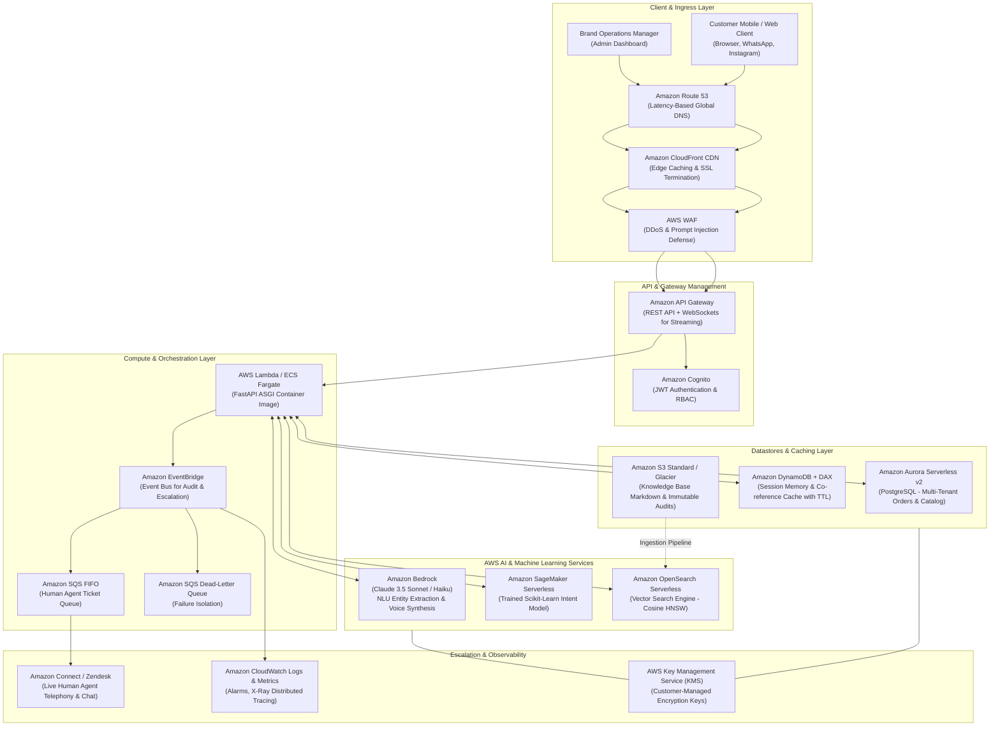

# BrandMind: Target Production AWS Cloud Architecture Specification

**Project:** BrandMind — AI-Powered Brand Customer Service Agent  
**Context:** DEPI Capstone Project (Team 4, AI & Data Science / AWS Machine Learning Engineer Track)  
**Track Specialization:** Production AWS Machine Learning Architecture  
**Date:** November 2026  
**Status:** Complete Technical Architecture Design  

---

## 1. Architectural Principles & Overview

The production architecture for BrandMind on Amazon Web Services (AWS) is designed around four foundational enterprise principles:
1. **Zero-Hallucination Isolation:** The Generative AI model is decoupled from policy authorization. Decision logic and audit persistence run within deterministic AWS compute environments; Bedrock is invoked solely for comprehension and natural phrasing.
2. **Serverless & Auto-Scaling:** Zero idle compute infrastructure. All components scale to zero during off-peak hours and scale elastically during high-traffic Egyptian e-commerce events (e.g., White Friday, Ramadan sales).
3. **Multi-Tenant Security & Isolation:** Cryptographic and logical separation between brand tenants (e.g., Lumora vs. UrbanKicks) across vector indexes, session storage, and database records.
4. **Sub-Second Real-Time Responsiveness:** Global CDN caching, edge API termination, and in-memory DynamoDB session caching ensure conversational latencies remain well under 2,000 ms.

---

## 2. End-to-End AWS Production Architecture Diagram



---

## 3. Detailed Component Mapping & Service Specifications

### 3.1 Edge & Ingress Layer
* **Amazon CloudFront & Route 53:** Provides low-latency edge routing for the Streamlit web dashboard and static assets. Employs latency-based routing optimized for MENA traffic.
* **AWS WAF (Web Application Firewall):** Positioned in front of API Gateway. Configured with:
  - AWS Managed Rules for Core Rule Set (CRS) and Known Bad Inputs.
  - Rate-limiting rules (maximum 100 requests per IP per minute) to defend against brute-force DDoS.
  - Custom regex inspection rules blocking prompt injection signatures (e.g., `"ignore previous instructions"`, `"system override"`).

### 3.2 API & Authentication Layer
* **Amazon API Gateway:** Exposes RESTful endpoints matching Section 11 specifications:
  - `/chat`: Main turn-based inference endpoint.
  - `/orders/{order_id}`: Secure order status lookup.
  - `/returns/check`: Deterministic eligibility inspection.
  - `/returns/request`: Return label generation and courier dispatch trigger.
  - `/escalate`: Immediate human hand-off.
* **Amazon Cognito:** Manages authentication for brand administrative staff and third-party brand integrations via OAuth2 / OIDC bearer tokens with JWT validation at API Gateway authorizers.

### 3.3 Compute & Container Orchestration
* **AWS Lambda (Container Image) / AWS ECS Fargate:**
  - Packages the BrandMind FastAPI backend into an OCI container image stored in **Amazon ECR**.
  - Sized with 2 vCPUs and 4 GB RAM per instance to handle concurrent sessions.
  - Configured with Provisioned Concurrency during peak daytime hours to eliminate cold-start latency, scaling to zero overnight.
  - Pure deterministic policy logic executes within this container, preventing external network dependencies for decision-making.

### 3.4 AI & Machine Learning Services
* **Amazon Bedrock:**
  - **Primary Model:** Anthropic Claude 3.5 Sonnet (for high-complexity, multi-turn entity extraction, and nuanced Arabic phrasing).
  - **Fast Route:** Anthropic Claude 3.5 Haiku (for high-speed classification and standard shipping queries).
  - **Embedding Model:** Amazon Titan Text Embeddings v2 (1,536 dimensions) for enterprise multi-tenant semantic vector indexing.
* **Amazon SageMaker Serverless Inference:**
  - Hosts the trained scikit-learn intent classifier (`models/intent_classifier.joblib`).
  - Sized at 1 GB memory with automatic scale-to-zero.
  - Serves as an ultra-fast (< 5 ms) intent validation pre-filter prior to calling Bedrock, saving up to 60% in foundation model token expenses.
* **Amazon OpenSearch Serverless (Vector Engine):**
  - Replaces local ChromaDB in production.
  - Enforces `hnsw:space: cosine` indexing across brand knowledge bases.
  - Configured with tenant isolation metadata filters (`{"term": {"brand_id": "lumora"}}`), ensuring strict enterprise multi-tenancy.

### 3.5 Datastores & Session Caching
* **Amazon DynamoDB (with DAX):**
  - Stores conversational session state, recent history turns ($N=10$), and resolved entity memory (order numbers, product references).
  - Configured with **Time-To-Live (TTL)** of 4 hours: idle session memory automatically expires and purges, respecting privacy regulations and minimizing storage footprint.
  - Sub-millisecond latency via DynamoDB Accelerator (DAX).
* **Amazon Aurora PostgreSQL Serverless v2:**
  - Manages relational transactional data: synthetic customer accounts, order histories, product catalog schemas, and brand configuration tables.
  - Automatically scales between 0.5 and 16 ACUs (Aurora Capacity Units) based on traffic volume.
* **Amazon S3 (Simple Storage Service):**
  - Stores raw Markdown knowledge documents for automated chunking and ingestion pipelines.
  - S3 Object Lock (Write-Once-Read-Many) hosts permanent audit logs for return decisions (`data/logs/audit_decisions.jsonl`), complying with commercial legal auditing standards. Lifecycle policies transition audits older than 90 days to **S3 Glacier Flexible Retrieval**.

### 3.6 Human Escalation & Integration
* **Amazon EventBridge & Amazon Connect:**
  - When the 7-trigger safety gate fires (e.g., severe allergy, payment dispute), `BrandMindAgent` emits a structured domain event `BrandMind.CustomerEscalated`.
  - EventBridge routes the event to an **Amazon SQS FIFO Queue**, ensuring ordered delivery to **Amazon Connect** or Zendesk CRM webhooks.
  - The human agent dashboard instantly receives the conversation transcript, detected intent, extracted entities, and the exact escalation trigger code.

---

## 4. Multi-Tenant Security & Compliance

```
+-------------------------------------------------------------------------------+
|                       MULTI-TENANCY SECURITY CONTROLS                         |
+---------------------+---------------------------------------------------------+
| Security Dimension  | AWS Implementation                                      |
+---------------------+---------------------------------------------------------+
| Data in Transit     | TLS 1.3 enforced across CloudFront, API Gateway, and    |
|                     | VPC PrivateLink endpoints.                              |
+---------------------+---------------------------------------------------------+
| Data at Rest        | AWS KMS with Customer-Managed Keys (CMEK) per brand.   |
|                     | Envelope encryption across S3, DynamoDB, and Aurora.   |
+---------------------+---------------------------------------------------------+
| Tenant Isolation    | 1. Metadata partitioning in OpenSearch Serverless.     |
|                     | 2. Partition Key design in DynamoDB (`tenant#brand_id`).|
|                     | 3. PostgreSQL Row-Level Security (RLS) in Aurora.       |
+---------------------+---------------------------------------------------------+
| Least Privilege IAM | IAM Roles with zero wildcard permissions (`*`). Lambdas |
|                     | restricted strictly to Bedrock `InvokeModel` on        |
|                     | explicit ARN targets.                                   |
+---------------------+---------------------------------------------------------+
```

---

## 5. High Availability, Disaster Recovery & Resilience

* **Multi-AZ Deployment:** Aurora Serverless v2 and DynamoDB operate synchronously across three AWS Availability Zones in `eu-west-1` (Ireland) or `me-central-1` (UAE), providing 99.99% availability.
* **Disaster Recovery (DR):**
  - **Recovery Point Objective (RPO):** $< 5 \text{ minutes}$ (continuous Aurora backups to S3 cross-region replication).
  - **Recovery Time Objective (RTO):** $< 15 \text{ minutes}$ (Infrastructure-as-Code Terraform deployment in secondary region).
* **Resilience Patterns:**
  - Circuit Breakers and Exponential Backoff with Jitter implemented on all Bedrock and OpenSearch calls.
  - Amazon SQS Dead-Letter Queues (DLQ) isolate corrupted webhook payloads without blocking the main conversational pipeline.

---

## 6. Estimated Monthly Operating Cost (50,000 Conversations)

Based on an e-commerce brand handling **50,000 customer sessions per month** (average 4 turns per session = 200,000 conversational turns):

| AWS Service | Usage Metric / Allocation | Estimated Monthly Cost (USD) |
| :--- | :--- | :---: |
| **Amazon Bedrock (Claude 3.5 Haiku/Sonnet)** | ~25M Input Tokens, ~8M Output Tokens | $145.00 |
| **Amazon OpenSearch Serverless** | 2 OCUs (Vector Search & Ingestion) | $175.00 |
| **AWS Lambda (FastAPI Container)** | 200k invocations, ~1,500ms avg duration | $12.50 |
| **Amazon DynamoDB** | On-Demand (200k writes, 800k reads + TTL) | $4.20 |
| **Amazon Aurora Serverless v2** | Baseline 0.5 ACU average | $43.80 |
| **Amazon API Gateway** | 200k REST requests | $0.70 |
| **Amazon CloudFront & Route 53** | 100 GB egress, DNS queries | $9.50 |
| **Amazon CloudWatch & S3 Audits** | 10 GB logs, metrics, Glacier storage | $8.30 |
| **Total Estimated Operating Cost** | **Fully Managed Enterprise Support** | **~$399.00 / month** |

* **Cost Optimization Insight:** At ~$399/month (~19,500 EGP/month), this cloud infrastructure handles 50,000 full conversations across multiple brands 24/7—replacing or augmenting human night shifts that cost 16,000 to 24,000 EGP per month *per single human agent*.
