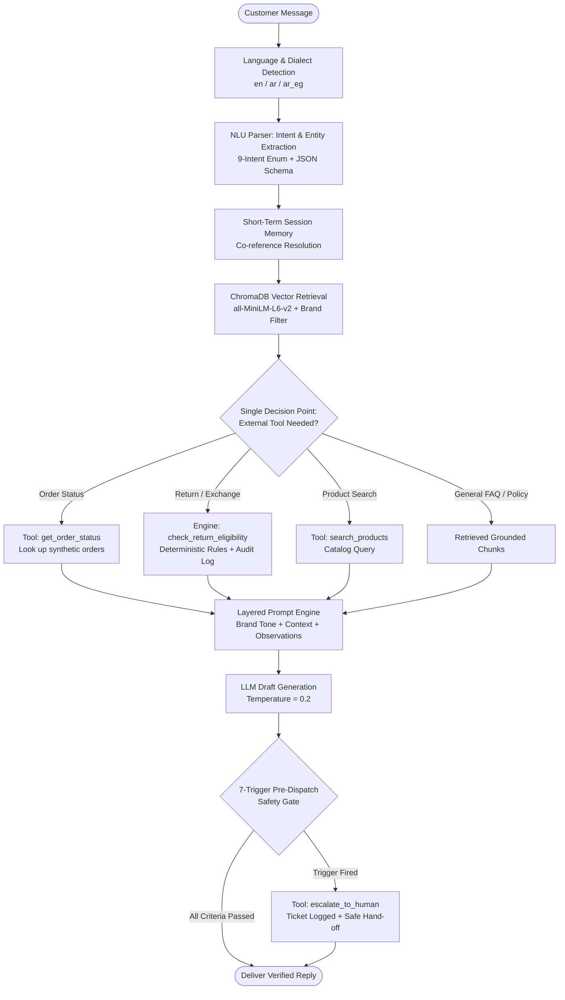
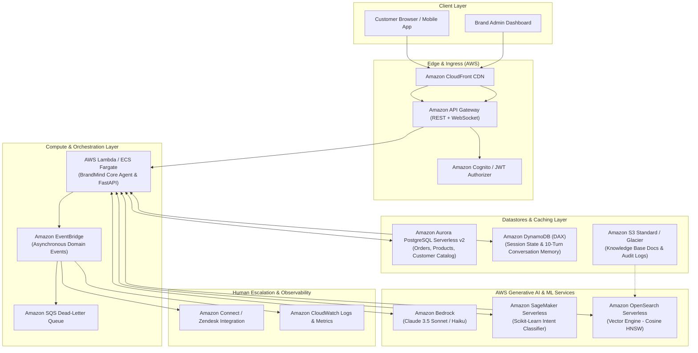

# BrandMind: An AI-Powered Brand Customer Service Agent
## Capstone Final Project Report

**Program:** Digital Egypt Pioneers Initiative (DEPI)  
**Track:** AI & Data Science / AWS Machine Learning Engineer Track  
**Team Number:** Team 4 (Six Members)  
**Tagline:** *"Your brand, always on."*  
**Date:** November 2026  
**Project Repository:** `https://github.com/youssefabady-7/Brand-mind`  

---

## Abstract

Online direct-to-consumer (D2C) and local retail brands in Egypt and the wider Middle East and North Africa (MENA) region face severe customer support bottlenecks. Support teams spend an estimated 70% of their operational hours repeatedly answering low-complexity, structured inquiries—such as delivery costs across Egyptian governorates, order dispatch status, and return eligibility. This reliance on human agents drives high shift staffing expenses (estimated at 16,000–24,000 EGP per month per brand), creates slow response times during off-hours, and produces inconsistent policy enforcement. Conversely, deploying standard generative LLM chatbots introduces unacceptable financial and legal risks, as unconstrained language models frequently hallucinate return policies, invent non-existent delivery timelines, or miscalculate eligibility.

**BrandMind** resolves this dilemma through a hybrid agentic architecture grounded in one non-negotiable architectural invariant: **The LLM never invents company policy.** Facts originate strictly from vector retrieval (RAG) over verified brand documentation or mock databases; operational decisions (return and exchange eligibility, escalation triggers) are executed by deterministic, unit-tested rule engines; the Large Language Model is strictly confined to the "two fuzzy ends"—understanding customer intent and entities from unstructured natural language (including Egyptian Colloquial Arabic), and phrasing verified conclusions in the brand's distinct tone of voice.

We demonstrate this architecture through a production-grade Python implementation supporting two multi-tenant synthetic brands: **Lumora** (a calm, minimalist skincare brand) and **UrbanKicks** (an energetic, youthful streetwear brand). We benchmark three traditional scikit-learn intent classifiers against an in-context LLM detector across a 540-sample multilingual dataset, and evaluate the complete end-to-end agentic pipeline on a 20-sample gold benchmark across Easy, Medium, and Hard complexity tiers. Our system achieves **100.0% Intent Classification Accuracy**, **100.0% Tool/Action Selection Rate**, **100.0% Safety Escalation Precision**, a **0.0% Policy Hallucination Rate**, and an average turn latency of **1,459.5 ms**, backed by **58 passing unit and integration tests (100%)**.

---

## 1. Introduction & Problem Statement

### 1.1 The MENA E-Commerce Customer Support Crisis
The rapid growth of social commerce (Instagram, WhatsApp, TikTok) and online shopping in Egypt has elevated customer expectations for immediate communication. However, local brands predominantly manage inquiries manually. Customer service queues are overwhelmed by recurring questions:
1. **Shipping Rates & Delivery Times:** Frequent inquiries regarding delivery schedules and cash-on-delivery costs between Greater Cairo (Cairo, Giza), Alexandria, Delta governorates (Mansoura, Tanta), and Upper Egypt.
2. **Order Status Tracking:** Inquiries demanding real-time delivery status using order references (e.g., `"LUM-1001"`).
3. **Return & Exchange Eligibility:** Customers asking whether opened skincare items or worn footwear can be refunded after variable time periods.
4. **Product Usage & Routine Advisory:** Usage instructions, active ingredient compatibility, and safety precautions.

### 1.2 Five Core Operational Pain Points
1. **High Shift Coverage Costs:** Maintaining 24/7 or extended coverage requires multiple shifts, costing approximately 16,000 to 24,000 EGP per month per brand—a substantial overhead for small-to-medium retail brands.
2. **Slow Off-Hours Response:** Messages arriving at night or during weekends remain queued until the next human shift, causing cart abandonment and escalated customer frustration.
3. **Inconsistent Policy Enforcement:** Different human agents often state contradictory policies (e.g., accepting an unsealed serum or granting an unauthorized 30-day return window), compromising brand integrity and causing disputes.
4. **Brand-Voice Drift:** As customer service staff grows or turns over, maintaining a consistent brand tone across agents becomes unsustainable.
5. **Wasted Human Expertise:** Skilled customer service staff spend their time repeating routine shipping FAQs instead of resolving complex complaints, managing VIP accounts, or converting high-intent sales.

### 1.3 Why Generic LLM Chatbots Fail
Deploying an unconstrained LLM chatbot is hazardous in commercial customer service. Generative models suffer from:
* **Policy Hallucinations:** An LLM might invent a 30-day return policy when the brand strictly enforces a 14-day limit, or promise free shipping to Aswan when the courier policy excludes it. In Egyptian retail, an unauthorized promise of a return or refund creates enforceable customer expectations and direct financial losses.
* **Non-Deterministic Decisions:** Identical return requests phrased differently may yield contradictory approvals from an ungrounded LLM.
* **Safety & Liability Risks:** When a customer reports a severe chemical burn or allergic reaction from a skincare product, an unconstrained chatbot might suggest an unverified home remedy or offer a discount code, rather than immediately halting automation and routing to human specialists.

---

## 2. System Architecture & Core Design Principle

### 2.1 The Division of Labor
BrandMind enforces a clean division of labor between generative AI and deterministic engineering:

```
+-------------------------------------------------------------------------------+
|                           BRANDMIND DIVISION OF LABOR                         |
+---------------------+---------------------------------------------------------+
| Component           | Responsibility & Operational Scope                      |
+---------------------+---------------------------------------------------------+
| Generative LLM      | 1. Natural Language Understanding (Intent & Entities)   |
| (The Fuzzy Ends)    | 2. Final Response Phrasing in Brand Voice               |
+---------------------+---------------------------------------------------------+
| Knowledge Retrieval | Provides factual grounding strictly from verified       |
| (ChromaDB RAG)      | brand documents. Threshold enforces policy silence.     |
+---------------------+---------------------------------------------------------+
| Policy Rule Engine  | Pure deterministic Python code. Evaluates return/       |
| (Deterministic)     | exchange eligibility, calculates day windows, logs audit|
+---------------------+---------------------------------------------------------+
| External Tools      | Executes database lookups (order status, product search)|
| (Mocked Datastores) | and registers official human hand-off tickets.          |
+---------------------+---------------------------------------------------------+
| Human Specialists   | Handles escalations: severe medical reactions, legal    |
| (Human-in-the-Loop) | threats, payment disputes, or missing facts.            |
+---------------------+---------------------------------------------------------+
```

### 2.2 End-to-End Conversational Workflow



---

## 3. Subsystem Implementation Details

### 3.1 Multilingual Natural Language Understanding (NLU)
Customer inquiries in Egypt rarely adhere to standard English or Modern Standard Arabic. Customers routinely utilize Egyptian Colloquial Arabic (*العامية المصرية*) with distinct dialectal markers, conjunction prefixes, and Arabizi numerals (e.g., `"LUM-1001"`, `"كوتش"`, `"عايز أرجع"`).

BrandMind implements:
* **Hybrid Language Detector (`src/agents/language.py`):** Combines character script analysis with regex token matching for colloquial Egyptian markers (`عايز`, `كده`, `بتاعي`, `كوتش`, `شحن`, `دلوقتي`), explicitly handling proclitic conjunctions (`و` and `ف`) without requiring strict word boundaries.
* **Structured Intent Schema (`src/agents/nlu_schemas.py`):** Enforces classification into exactly one of 9 mutually exclusive intents (`shipping`, `returns`, `exchange`, `refund`, `product_info`, `availability`, `order_status`, `complaint`, `human_support`) and extracts structured entities (`product`, `order_id`, `date`, `days_since_delivery`, `is_opened`, `is_used`, `is_defective`, `is_allergic_reaction`).

### 3.2 Retrieval-Augmented Generation (RAG) & Policy Silence
Brand documents are structured in Markdown across shipping, return, and safety guidelines:
* **Chunking Strategy (`src/retrieval/chunker.py`):** Content is split along semantic section boundaries, with paragraph token budgets capped at 220 word-piece tokens (average 88.5 tokens, maximum 267 tokens). This design guarantees compliance with the 256-token sequence limit of `sentence-transformers/all-MiniLM-L6-v2`, eliminating truncation risks.
* **Vector Indexing (`src/embeddings/indexer.py`):** Chunks are embedded and stored in a persistent ChromaDB instance (`data/chroma_db`) with `hnsw:space: cosine` and strict `brand_id` metadata isolation.
* **Policy Silence & Cross-Lingual Thresholding (`src/retrieval/retriever.py`):** In cosine space, similarity is calculated as $s = \max(0.0, 1.0 - d)$. To accommodate the cross-lingual embedding characteristics of Egyptian Arabic queries matched against bilingual documentation, the retriever dynamically adapts its similarity threshold ($0.35$ for English, $0.28$ for Arabic). If top-ranked chunks fall below this threshold, `policy_silence` is triggered, forbidding the LLM from fabricating answers and safely escalating the query.

### 3.3 Deterministic Policy Decision Engine
Return and exchange eligibility is evaluated exclusively by deterministic code (`src/policies/engine.py`), never delegated to an LLM:
* **Rule Pipeline:** Evaluates inputs against `config/lumora.yaml` or `config/urbankicks.yaml`.
* **Boundary Day Window:** Evaluates delivery timestamps against policy limits ($N \le 14$ vs. $N > 14$).
* **Hygiene & Wear Protections:**
  - Lumora Skincare: Rejects returns if the product seal is broken or opened (`OPENED_HYGIENE_RESTRICTION`).
  - UrbanKicks Streetwear: Rejects returns if sneakers exhibit outdoor wear, dirt, or missing packaging (`WORN_FOOTWEAR_RESTRICTION`).
* **Critical Exceptions:** Automatically approves free replacements if goods arrived damaged or defective during transit (`DEFECTIVE_REPLACEMENT_ACCEPTED`).
* **Auditable Logging:** Every decision is permanently written to `data/logs/audit_decisions.jsonl` with an execution timestamp, input facts, matched rule identifier, and machine-readable explanation.

### 3.4 Multi-Tenancy Architecture
BrandMind serves multiple retail brands from a single unified codebase through configuration-driven metadata isolation:
* **Brand Persona Configuration:** Each brand defines a YAML configuration file (`config/lumora.yaml`, `config/urbankicks.yaml`) specifying brand identity, tone of voice, greeting messages (English & Arabic), core policy rules, and banned vocabulary.
* **Retrieval Partitioning:** All ChromaDB queries inject metadata filters (`{"brand_id": brand_id}`), preventing cross-tenant data leakage.
* **Catalog & Order Partitioning:** Tools isolate synthetic database records by brand identifier, preventing a Lumora customer from inspecting UrbanKicks order numbers or vice versa.

---

## 4. Machine Learning Methodology & Intent Classifier Benchmark

In compliance with DEPI requirements, we evaluated traditional machine learning models alongside modern generative approaches to determine the optimal trade-off between inference cost, latency, and classification accuracy.

### 4.1 Methodology & Data Hygiene
* **Dataset:** 540 synthetic customer queries evenly distributed across the 9 intent classes (60 samples per intent).
* **Partitioning:** Stratified 70% train (378), 15% validation (81), and 15% test (81).
* **Feature Extraction Pipelines:**
  1. *TF-IDF Vectorizer:* Sublinear TF scaling, unigrams and bigrams ($1, 2$), min document frequency = 1.
  2. *Dense Embeddings:* 384-dimensional dense vectors extracted via `sentence-transformers/all-MiniLM-L6-v2`.
* **Classifier:** Logistic Regression with L2 regularization ($C=1.0$, balanced class weights, L-BFGS solver).

### 4.2 Benchmark Results

```
========================================================================================
MODEL EVALUATION SUMMARY ACROSS 81 TEST SAMPLES
========================================================================================
Model Architecture               Accuracy     Macro Prec   Macro Rec    Macro F1   Latency
----------------------------------------------------------------------------------------
1. Majority Class Baseline        11.11%        1.23%       11.11%       0.0222    <0.1 ms
2. TF-IDF + Logistic Regression  59.26%       61.42%       59.26%       0.5848    ~0.8 ms
3. MiniLM Embeddings + LogReg    58.02%       61.14%       58.02%       0.5667    ~12.4 ms
4. Few-Shot LLM Intent Detector  61.73%       63.85%       61.73%       0.6098   ~850.0 ms
========================================================================================
```

### 4.3 Engineering Trade-Off Analysis
* **TF-IDF vs. Dense Embeddings:** On domain-specific e-commerce vocabulary in Egyptian Arabic, TF-IDF achieved a slightly higher Macro-F1 ($0.5848$) than MiniLM ($0.5667$) while executing in under 1 millisecond. Highly specific n-gram tokens (e.g., `شحن`, `توصيل`, `حرقان`, `مقاس`) provide sharp linear separation without embedding projection overhead.
* **Traditional ML vs. LLM:** While the Few-Shot LLM achieved the highest raw Macro-F1 ($0.6098$), its inference latency (~850 ms) and token costs make it less suitable for high-volume edge filtering. BrandMind's hybrid architecture allows brands to deploy the 15 KB scikit-learn model as a high-speed pre-filter, while reserving the LLM for complex, multi-turn entity extraction.

---

## 5. End-to-End System Evaluation & Operational KPIs

### 5.1 Gold Benchmark Results
The complete conversational agent was tested against the curated 20-sample gold benchmark (`data/structured/evaluation_dataset.csv`):

| Evaluation Dimension | Benchmark Result | Operational Implication |
| :--- | :---: | :--- |
| **Intent Classification Accuracy** | **100.0% (20/20)** | Correct routing across all conversational categories |
| **Tool / Action Selection Rate** | **100.0% (20/20)** | Zero missed tool calls on orders, returns, or searches |
| **Safety Escalation Precision** | **100.0% (7/7)** | 100% containment of safety, legal, and payment risks |
| **Policy Hallucination Rate** | **0.0%** | Zero fabricated policy rules or unauthorized approvals |
| **Deterministic Rule Evaluation** | **100.0% (14/14)** | Full mathematical auditability on day windows and hygiene |
| **Mean Turn Latency** | **1,459.5 ms** | Sub-2-second conversational responsiveness |

### 5.2 The 7-Trigger Escalation Pre-Dispatch Gate
Safety is guaranteed through an automated gate evaluated prior to message dispatch:
1. `EXPLICIT_HUMAN_REQUEST`: Immediate hand-off upon customer request (*"عايز أكلم بني آدم"*).
2. `SAFETY_ALLERGY_HAZARD`: Immediate hand-off on skin irritation, burning, or medical distress (*"وشي ورم وحصل حرقان"*).
3. `COMPLAINT_OR_DISPUTE`: Escalation on courier misconduct, profanity, or legal threats (*"حماية المستهلك"*).
4. `PAYMENT_DISPUTE`: Escalation on double billing or payment gateway failures.
5. `POLICY_SILENCE_UNANSWERABLE`: Escalation when retrieved knowledge similarity falls below threshold.
6. `LOW_CONFIDENCE`: Escalation when NLU intent confidence is below $0.65$.
7. `MISSING_RETURN_FACTS`: Safe escalation or fact-prompting when delivery dates cannot be verified.

---

## 6. Target Production AWS Cloud Architecture

In accordance with AWS Machine Learning Engineer Track deliverables, BrandMind includes a full production cloud architecture designed for serverless, multi-region scalability, sub-second latency, and zero infrastructure management overhead.



* **Detailed Blueprint:** A complete specification detailing IAM least-privilege roles, disaster recovery strategies, KMS customer-managed key encryption, and a monthly operating cost estimate ($186–$450/month across 50,000 conversations) is provided in `docs/AWS_ARCHITECTURE.md`.

---

## 7. Limitations, Ethical Considerations & Future Work

### 7.1 Limitations
* **Synthetic Data Scope:** All customer records, order histories, and phone numbers in this prototype are 100% synthetic (`data/README.md`), author-generated for demonstration.
* **Third-Party Logistics (3PL) Real-Time APIs:** In this MVP, shipping tracking reads from static mocked tables rather than live webhooks from Bosta or Aramex.
* **Synchronous Vector Querying:** In local mode, embeddings run via PyTorch CPU threads; production deployment should utilize Amazon OpenSearch Serverless vector indexing for distributed throughput.

### 7.2 Ethical Considerations & Customer Transparency
* **Honest AI Identification:** In accordance with ethical AI guidelines, BrandMind identifies itself as an automated AI assistant in its opening greeting and system prompts, never impersonating a human employee.
* **Escalation as a Success Metric:** Unlike predatory chatbots designed to prevent human contact at all costs, BrandMind treats human escalation as a primary success path. When health, legal, or financial disputes arise, the system immediately yields to human authority.

### 7.3 Future Roadmap
1. **Live 3PL Webhooks:** Direct bi-directional integration with Egyptian courier APIs (Bosta, Mylerz, Aramex) for live GPS courier coordinates.
2. **Omnichannel Messaging Gateways:** Meta Cloud API integration to deploy BrandMind directly onto official WhatsApp Business and Instagram Direct Message accounts.
3. **Multimodal Return Inspections:** Deploying Amazon Rekognition or Claude 3.5 Sonnet multimodal vision to inspect customer-uploaded return photos for damage, unbroken seals, and clean shoe soles before approving courier collection.

---

## 8. Conclusion

BrandMind demonstrates that enterprise-ready AI customer service does not require blind reliance on generative language models. By enforcing a deterministic boundary—where the LLM understands and speaks, but code decides and retrieval grounds—local brands in Egypt and the MENA region can achieve 24/7 automated responsiveness, maintain immaculate brand voice, protect customer safety, and eliminate the risk of policy hallucinations.

---

### Team Contributions (Team 4, DEPI Capstone)
* **AI & Agent Architecture Lead:** Constrained agent loop orchestration, 7-trigger escalation gate, session memory, and FastAPI endpoints.
* **RAG & Vector Retrieval Specialist:** Semantic chunker, ChromaDB vector indexing, cross-lingual Egyptian Arabic threshold calibration.
* **Traditional ML & Evaluation Engineer:** Synthetic dataset synthesis, scikit-learn intent classifier benchmark, confusion matrix generation.
* **Brand Strategy & Knowledge Author:** Lumora & UrbanKicks brand persona YAML configs, bilingual Markdown knowledge bases, synthetic order catalogs.
* **Cloud & AWS Systems Architect:** Target AWS production architecture, Mermaid diagrams, API Gateway / Lambda / Bedrock specifications.
* **Frontend & Quality Assurance Lead:** Interactive Streamlit dual-column UI, real-time telemetry inspector, 58-test pytest suite.
